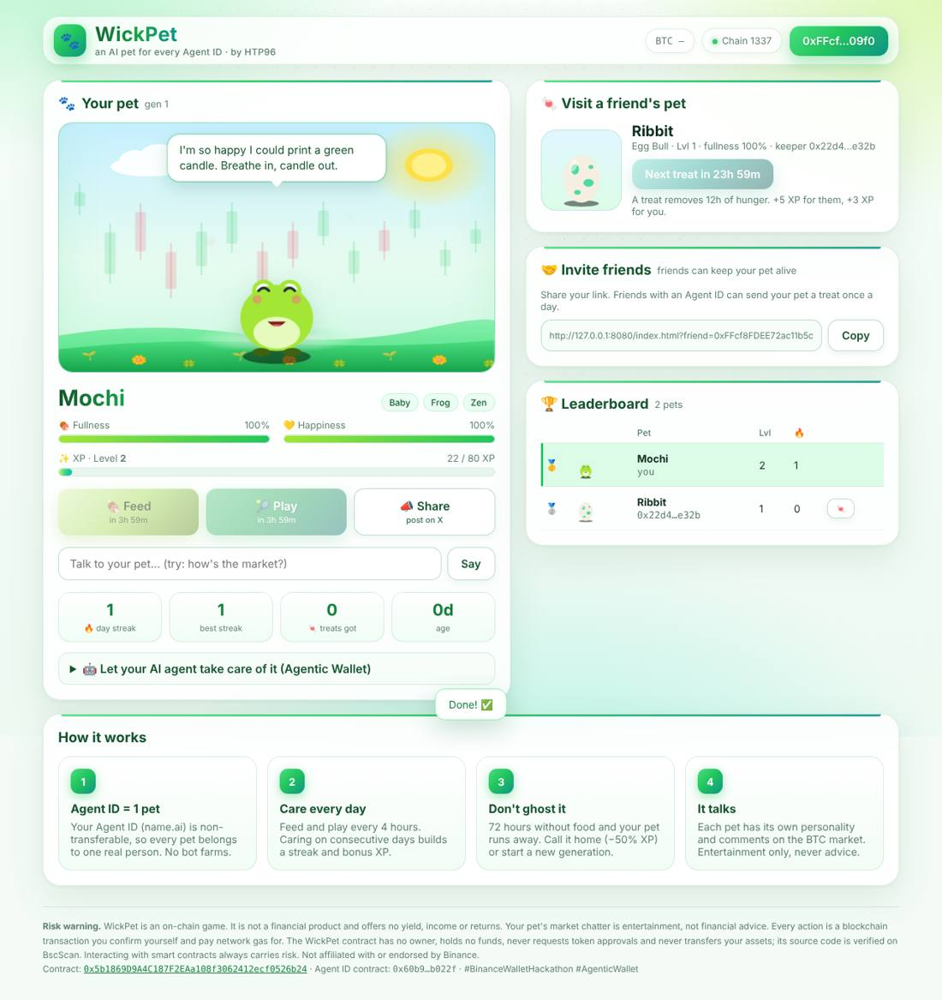

# 🐾 WickPet — an on-chain AI pet for every Agent ID



**WickPet** turns your Agent ID (`name.ai`) into a living companion on BNB Chain.
Every Agent ID holder can adopt **exactly one** pet. Feed it and play with it every day, or after 72 hours
without food it **runs away from home**. Friends can send treats to keep each other's pets alive. Each pet has its own
AI personality and jokes about the BTC market (entertainment only, never advice).

Built by **HTP96** for the Binance Wallet × BNB Chain **Agent ID Hackathon** (Nov–Dec 2026).

---

## Why Agent ID is the core of the game

| Agent ID property | How WickPet uses it |
|---|---|
| One per user, non-transferable | **1 Agent ID = 1 pet.** Bot farms can't spin up 100 pets, and pets can't be bought or sold, so leaderboards and streaks reflect real care. |
| On-chain identity of an Agentic Wallet | **Access control:** every write function (`adopt`, `feed`, `play`, `sendTreat`, `callHome`) checks `AgentID.balanceOf(msg.sender) > 0` on every call. |
| Built for AI agents | **Your agent can be your pet sitter.** The included agent skill lets the user's AI agent read the pet's state, talk as the pet, and prepare feed/play transactions for the Agentic Wallet. The user confirms every transaction. |
| Social identity (`name.ai`) | **Friend treats:** Agent ID holders visit each other's pets through invite links and keep them alive, which creates daily, organic, person-to-person interactions. |

Daily cooldowns (4h), streaks and the 72h runaway timer create a reason to come back every day.
That means real, recurring interactions from real Agent ID holders.

## Features

- 🥚 **Adopt** an egg. Species is decided on-chain: Bull, Bear, Whale, Frog, Cat or Dragon.
- 🍖 **Feed** and 🎾 **play** every 4 hours. Eggs hatch after the first feed and play, then grow from Baby → Teen → Adult → 👑 Legend.
- 🔥 **Daily streaks** with bonus XP (up to +10 per day).
- 💨 **Runaway:** 72h without food and the pet leaves. **Call it home** (−50% XP, streak reset) or adopt a new generation.
- 🍬 **Treats:** once per day per friend; removes 12h of hunger, +5 XP for them, +3 XP for you.
- 🗣️ **AI personality:** six personalities (Degen, HODLer, Scalper, Doomer, Moonboy, Zen). The pet reacts to its mood and the live BTC 24h change. Optional LLM voice through a small worker.
- 🏆 **Leaderboard**, invite links, and a one-tap "Share on X" post with `#BinanceWalletHackathon #AgenticWallet`.
- 🤖 **Agentic Wallet mode:** copy-paste instructions plus an agent skill so an AI agent can take care of the pet (with user confirmation).
- 📱 Works on mobile, with a built-in demo mode before deployment.

## Repository layout

```
contracts/WickPet.sol          the game contract (no owner, no funds, non-payable)
contracts/test/MockAgentID.sol test-only Agent ID stand-in (never deployed on mainnet)
test/wickpet.test.js           20 checks on a local chain
scripts/compile.js             compiles + writes BscScan verification input
scripts/deploy.js              deploys (mainnet or testnet rehearsal) and configures the web app
scripts/verify.js              verifies the source on BscScan (Etherscan API V2)
docs/index.html                 the dApp (single file, no build step), served by GitHub Pages
docs/deploy.html                one-click deploy page using your browser wallet (no private key)
agent-skill/wickpet/           skill for AI agents (status reader + unsigned tx builder)
ai-worker/worker.js            optional LLM voice for pets (Cloudflare Worker)
```

## Smart contract

- **Agent ID contract (BNB Chain):** `0x60B9262456dE011F7d15a54CdD8c48bAaa8B022F` (SPACE ID Agent ID, ERC-721, non-transferable)
- **WickPet contract:** `TO_BE_FILLED_AFTER_DEPLOYMENT`

### Permissions and safety disclosure

- **No owner, no admin, no upgrade, no pause.** Nothing can be changed after deployment.
- **No funds:** every function is non-payable. The contract never holds tokens, never requests approvals and never transfers user assets. No mint, tax, freeze or withdraw functions exist.
- The only external call is a read-only `balanceOf` on the Agent ID contract.
- No QR or pairing-code login, no server-side sessions, and no collection of seed phrases, keys or pairing codes. Users sign each transaction in their own wallet.
- The web app shows a risk warning and makes no promise of income or returns.

### Functions

| Function | Who | Rule |
|---|---|---|
| `adopt(string name)` | Agent ID holder | one living pet; name is 1–20 chars `[A-Za-z0-9 ._-]` |
| `feed()` | pet owner | every 4h, +10 XP (+streak bonus) |
| `play()` | pet owner | every 4h, +8 XP (+streak bonus) |
| `sendTreat(address friend)` | Agent ID holder with a pet | once/day per friend; −12h hunger; +5/+3 XP |
| `callHome()` | owner of a pet that ran away | −50% XP, streak reset |
| `getPet(address)`, `getPets(offset, limit)`, `keeperCount()`, `hasAgentId(address)` | anyone | read-only views |

Level is `1 + floor(sqrt(xp / 20))`. Hunger goes 0→100 over 72h; happiness goes 100→0 over 48h.

## Run locally

```bash
npm install
npm test            # compile + 20 checks on a local chain
```

Open `docs/index.html` in a browser to try **demo mode** (no contract needed).

## Deploy

**Easiest:** open `docs/deploy.html` (e.g. on GitHub Pages) in a browser with a wallet, connect, click **Deploy** and confirm.

Or from the command line:

```bash
# 1) rehearsal on BSC testnet (deploys a mock Agent ID; your wallet becomes a "holder")
PRIVATE_KEY=0x... npm run deploy:testnet

# 2) mainnet (uses the real Agent ID contract)
PRIVATE_KEY=0x... npm run deploy:mainnet

# 3) verify the source on BscScan
ETHERSCAN_API_KEY=... node scripts/verify.js <WickPetAddress>
```

`deploy.js` writes the address into `docs/index.html` automatically. Host the `docs/` folder on any static host
(GitHub Pages, Vercel, Netlify, Cloudflare Pages).

Manual verification: BscScan → contract → **Verify & Publish** → *Solidity (Standard-Json-Input)* → compiler
`v0.8.28+commit.7893614a` → upload `build/WickPet.standard-input.json` → paste the constructor arguments printed by
`deploy.js`.

### Optional: LLM voice

Deploy `ai-worker/worker.js` as a Cloudflare Worker with an `ANTHROPIC_API_KEY` secret, then set
`CONFIG.aiEndpoint` in `docs/index.html`. Without it, pets use the built-in personality engine.

### Optional: AI agent skill

Copy `agent-skill/wickpet` into your agent's skills folder and replace `WICKPET_ADDRESS`. The agent can then run
`node scripts/wickpet.mjs status <address>` and `node scripts/wickpet.mjs tx feed`, and submit the transaction from
the Agentic Wallet after the user confirms.

## Risk warning

WickPet is an on-chain game. It is not a financial product and offers no yield, income or returns. Pets' market
chatter is entertainment, not financial advice. Every action is a blockchain transaction you confirm yourself and
pay network gas for. Interacting with smart contracts carries risk. Not affiliated with or endorsed by Binance.

## License

MIT © 2026 HTP96
